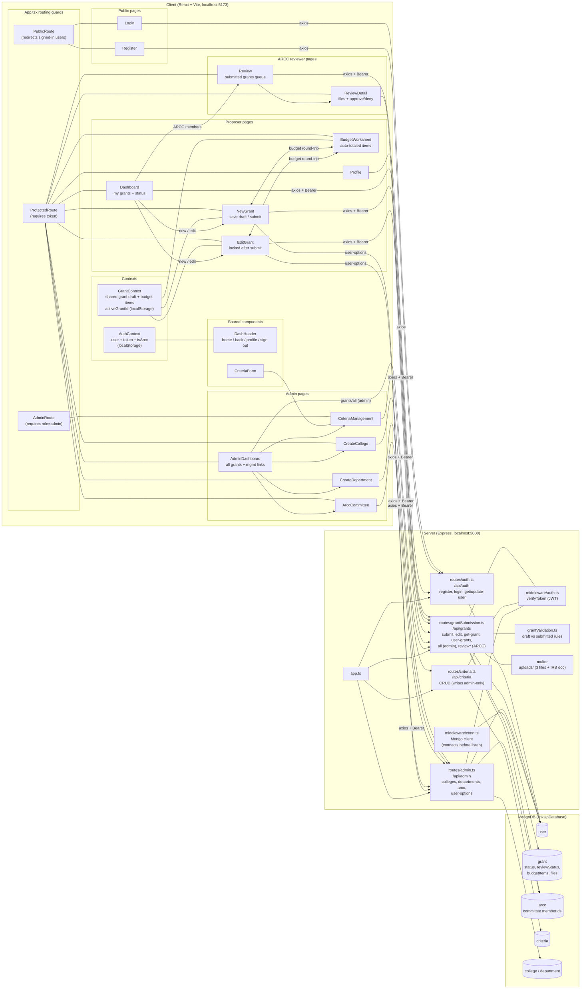
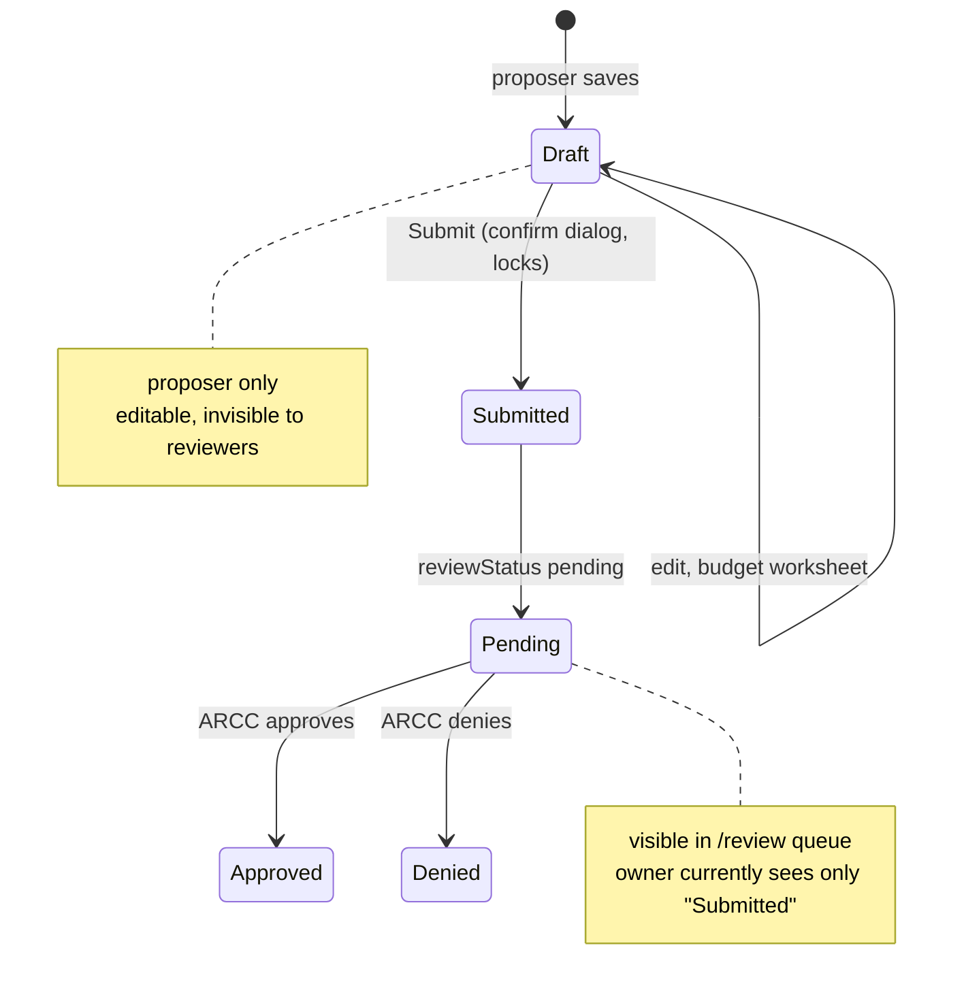
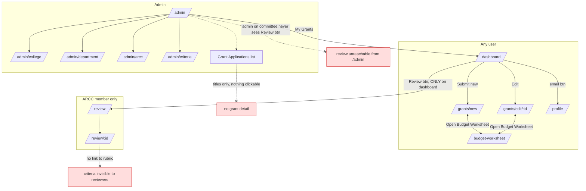
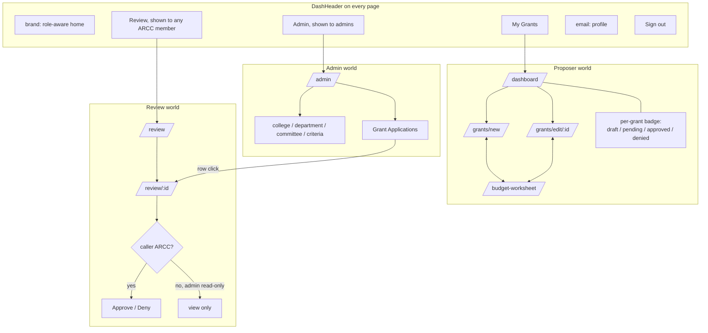

# Architecture and navigation

Diagrams are Mermaid; GitHub renders them inline, or paste the code blocks into [mermaid.live](https://mermaid.live).

## Project overview

`review*` covers `/review`, `/review/:id`, `/review/:id/files/:savedName` (GET) and `/review/:id` (PUT).

## Grant lifecycle

## Navigation today (dead ends marked)

## Proposed navigation

Planned changes: ARCC membership moves into AuthContext so the header can show the Review button on every page (admins included); proposer dashboard shows pending/approved/denied per grant; admins open grants read-only through the review detail page, with approve/deny gated by actual committee membership.

