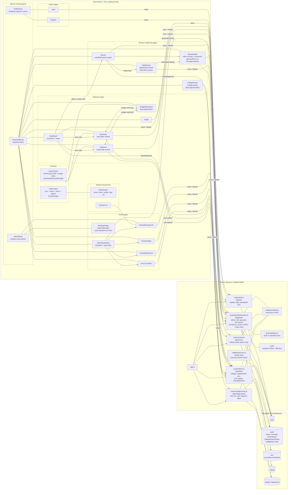
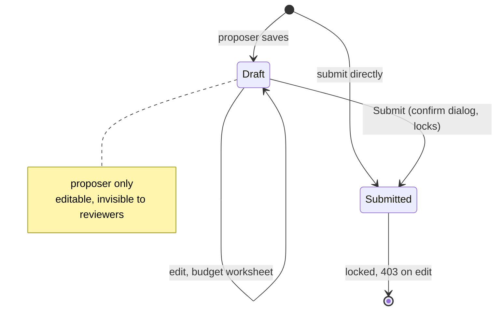
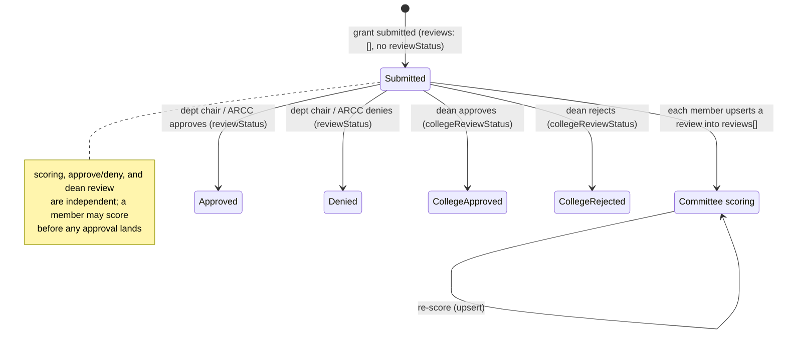
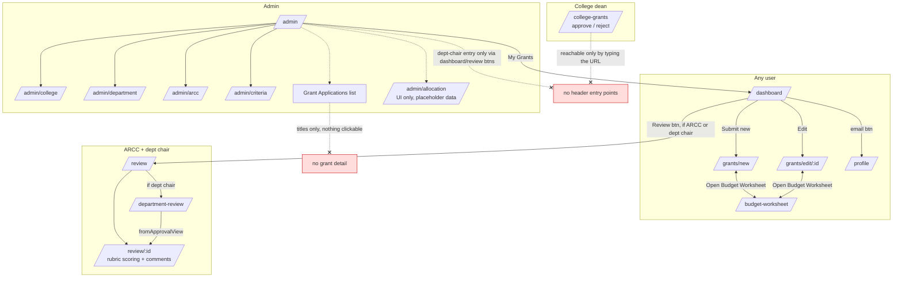
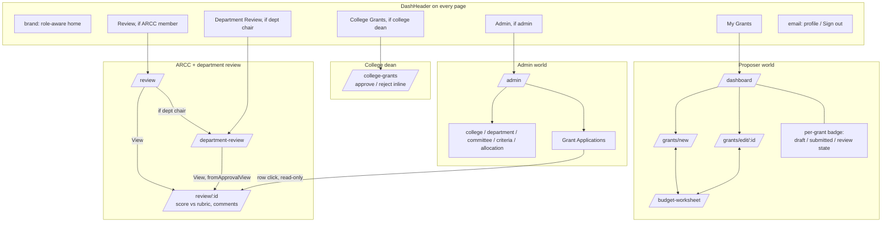
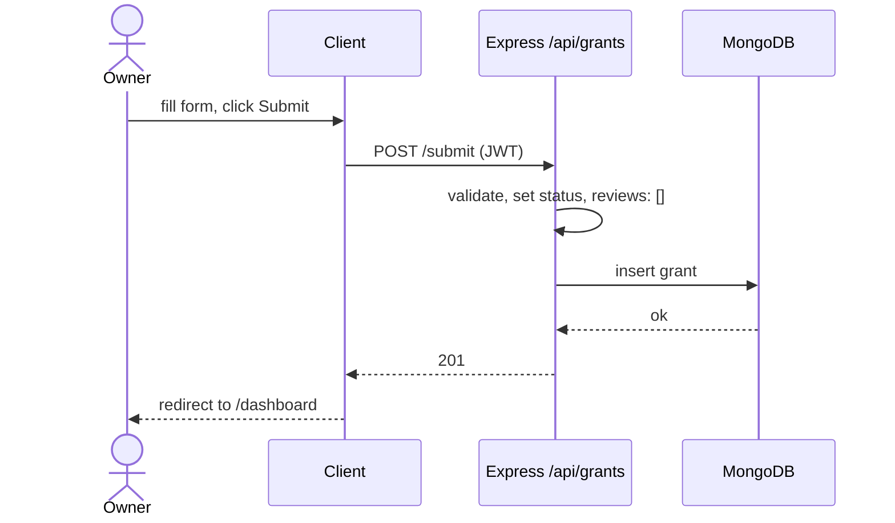
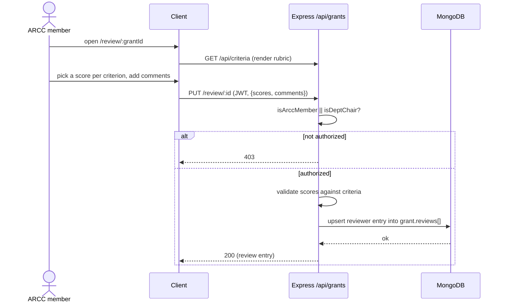

# Architecture and navigation

Diagrams are Mermaid; GitHub renders them inline, or paste the code blocks into [mermaid.live](https://mermaid.live).

## Project overview

_[Open in mermaid.live](https://mermaid.live/edit#pako:eNqNV21v4kYQ_isjS6VcA-WqqqqUtpEAc4SKEORArhXuh8UezDa217e7houa_vdqdm38AlTJhwRm5_3lmck_TiBCdG6dXSyOwZ5JDXPPTwEAVL6NJMv2MJLiqFDCxnfGMcdUQ9dDFmi4gWeusQexCFi8F0rf_vTDzz9-8J2_rAb6CbnEQHORwmrkpxX9pN0TueZpRNqHWfa9Vl9BFqQoZzJUDXX0s1yPNr6zzLcxD0gaf93KwV1XorWlQPEoxbDPU8gVSvXhXIP3uCIVUmgMNIYNLV9yLlGBFi-YnosO3QfyNEx4eklKihh_Y_TaFMU0vBj9WKQav2rVMrJe3Y9Xf5ChXO8LHmOJAoIb6xzcAFdDGQTWB1OFJy0ki_Dc76k3XKyszqlkqa4rVXsmMYSI6BBKtqPSbvMwQg1cY6IMFws0P6ARnoXwP-auxfpkzWx8p_gUiCQTKab6vMb3k6E78Ta-4zK1v0cWojRO7EWCMIAtC15gAJkUOx4TgUoOItdnisbebPXp0aOijSXXKDn7JGTyLodtiy1ZhApOHQcZfT-zM3-czhYb35mLiKdnr95kuvEdDyOuNMp3GV8rlJVpKTJBpb9s3B0-3Re52gomQ5Oq5NVWVMENKM10fi63mHze-M4Cj6aqthfYAYseGJAzCT_P6cSd0fhMQq4rwVgELxgC22mU1wRHa3c6IdGRaa7PQr6oPaJVwHIt-lpoFmNo2-7S3H6azSc2IVT5d2XSwwPH4ymX9it0gGWZFAcWX0mqN3k-cdvUmKB0OSkKvuSY4yU51wRpRV3UjMdGgcy3kgegAiEJ3m5oABJq_19sAow_OAgxfYUDZ7CTIhkWTj5zPJ7XfbJcWTddzHTN1UGIGZOalPdlRQ4x0xDsGZffqiKI84GhTh2LOMbIDrud_kFgSf2oooXIUii9lvg3BvpdBTHoeaqH-XalBsOisw1Ps71ZHFf9nUSJhpinLxfieZzPJ9OJmX9kGovQLubyxOSe0nfukjceLylHhLxjkZiWwIu4U8OcB5ayCM8Umgy1UlXhJcqDXbvFp-7kayZRqcbG_fjx4_9t3JPby-XGd5jZsA3254k3-_TnxncSHoYxHpnEAcv1_vuiyAeUfPe6Mgun-_vnVdPY-HGxaMoGIk1L2QeRRgICczTYJUWvZkdvcSckQkyA2NqVz8P5zN34jqnuM4t5yCicUqkFp4OCah5lHrea52E9X5n9keSxLnZHnsWChWoA3R-BwIMaZ-aNIBSBdaCWrfXqnqTpEkHVyMeAZdwQ7EgXkE4liXjagwj1IM9CprFPu7rhlNnBNbUmwCeKQqlagMZCbcxsnD3AkH5HqO0M9sx1U8xj7zQTXXt99MDO_XfQpY6FG6iGv5nuofswW9SDJflmtEQxXwsQUD2oAEb1gMkg6J3uk77IqF6qB8EegxeCpjGZbTaON6unIijmpGG3JBrK2Fu70D0SSYHxqC_S-LXVjtO6zjqINRVfwTLqRhhQimFQAlu_BWyXJtX2-cZ3zAd3BF3ConXmMs22TLXuo_H6aeJtur5jG-RD0__hYkVvUbWRze4u66k2f5Ufn-xDvTDe2YM942a0Tnu261sWqTvIICsPyaDENEgw2aKchW0Rg21d3ynr035-nM_Ns_UJBrVmqVhrefzmmwIj4MhpM1rqcj2Cfr9vLyvo0A1VPHiPK_NCywE6dMVAxxwl0ClODOiUt4IRfLa_XfNQLE3owHgKHbti6IvdEwUDPRigtyaH7oOxSJEXFHuiG6o9Vi29vLPNwwXPLFd5ldaUnlJBmxBSduCRgT3oJoynQP-fqQ-WyXjc79-9-U6KRxgYZPCdt5o9y0jff7WMxTkvRZ6GfS15Rvx1l4yX72WueWDQRcgavBCzN3m2nJTpfv-uSH-D9uY7fNeSK4pTWCkqZXnPr6G3htZh6dS1UlKRm6keLmcQsDgu_v2qdVqtgax19pULRSbNaqhlodF_NV64gREyiSYsi_xV9Bfa8Z2iJGRZq-l7s2hatNb0qqrx1Gul6q0AGjWorY621WvpvGbGLpRGiqoA2yuhyX6Wyvo-aTNT0NdjtRk5lVrZE6oOMMPl0rSLqSh0ipgNJJCRol3M32l9uj0ztfZugo49V6BTnByVa3W2E4qQ3jZ5PG3SKiRAqcx9FGAFOp5tcdohLZ_uivVBDpup7NTZTsbvLEJf5iodv7MoX3ewrp4UlM2xWBjvzepzek6CMmE8dG6df4jDd_QeE_SdW_CdEHcsj7Xv-Om_Ts-h__ieXtPAudUyx55j7yaXs0iyxBL__Q9_RZ7f)_

`review*` covers `/review`, `/review/:id`, `/review/:id/files/:savedName`,
`/review/department` (GET), `/review/:id` (PUT, stores a reviewer's per-criterion scores

- comments) and `/review/approval/:id` (PUT, sets approve/deny). The GET review endpoints
  and both PUTs are open to ARCC members and department chairs (`isArccMember || isDeptChair`).

## Grant lifecycle

A grant carries several independent fields (`server/src/routes/grantSubmission.ts`,
`server/src/routes/collegeGrants.ts`). `status` (`draft` / `submitted`) controls
editability. Reviewing is split across three concurrent tracks that all live on the
grant document, no separate Review entity:

- **`reviews[]`** — an embedded array, one entry per committee member, each holding
  per-criterion `scores` and `comments`, upserted on re-submit. Created empty at submit.
- **`reviewStatus`** (`null` / `approved` / `denied`) — the approve/deny outcome, written
  by a department chair or ARCC member through the approval route. It is no longer set to
  `pending` at submission (that was the pre-merge behavior); a freshly submitted grant has
  `reviews: []` and no `reviewStatus`.
- **`collegeReviewStatus`** (`approved` / `rejected` / unset) — the college dean's
  decision, written only for a grant that requests money from that dean's college; unset
  reads as pending.

Editing track (`status`):

_[Open in mermaid.live](https://mermaid.live/edit#pako:eNpdkcFOwzAQRH9ltCdAroSAkw-c-gc9Yg5OvEmtJt7K3qSqqv47Sgy0sKeV582s175QK4HJUlGvvI2-z37czC8uAcDH0yc2m3dss-8UFscsRymcUfzM5S-zm5oxqnKARVl7hJi51eFcwRpyH8chqkEzhZ4VJ8mHsmfW__R9cO3x0ErqYh4Roh-kNxikPZTH6rzxi3u5nl11DgZvz6-QtA52qeJJlJFjv1dIV8dWYanfhSX9rLHU4vfNwAYxzbHEZmCoIPMc-cT5-2U4hTWdDI2cRx8DWbosmiPd88iOLBwF7vw0qCOXrmTITyq7c2rJap7Y0HQMt5-ph9cvjkOOig)_

Review tracks (run once submitted, concurrently):

_[Open in mermaid.live](https://mermaid.live/edit#pako:eNqFk9Fq6zAMhl9F6GobKYNdZjAY2ROsl3Uv1FhNfYjlYCsdZezdR-ykOWVnnEtZv7__l4U_sQ2WscakpPzmqIvkN-cnIwAAu4c9bDYvsB0P3qmyhRq6SKKQrid3kc-OP1INu30FEqDUWyUd072RQsp4MNgEn-8xpDZEJ51BoATbucja1S17lxbUwNSewLM_cIRxSBw1Ac124EQX67Tbz6D56i0m8mbyZrgrkGvGW9_XYYjhnEe2PCi0J3IRHuH1vWmASjMt01-n_cl5Y3G_UOzU-sn4F6UJfc8d34Qi-StHWwTv_4vTLLo_3OoKirn-lVNIEpQhuu6kEI4rtzTzlssjV0uuR8tyqYDELi4TddVTZHBieWCxLPoMtOzX0yXTeBUf-DhtjeQy46mHnsSmImGxOSBW6Dl6chZr_Jx6BvXEng3WYNDykcZeDRr5wgpp1LC9SIu1xpErHAe7_oNy-PUN8P8PvA)_

| status            | field written         | Trigger          | Actor                | Route                                 |
| ----------------- | --------------------- | ---------------- | -------------------- | ------------------------------------- |
| (new) → draft     | none                  | save as draft    | owner                | `POST /api/grants/submit`             |
| (new) → submitted | `reviews: []`         | submit directly  | owner                | `POST /api/grants/submit`             |
| draft → draft     | none                  | edit, save draft | owner                | `PUT /api/grants/edit/:id`            |
| draft → submitted | `reviews: []`         | submit           | owner                | `PUT /api/grants/edit/:id`            |
| submitted         | `reviews[]` upsert    | score the rubric | ARCC member or chair | `PUT /api/grants/review/:id`          |
| submitted         | `reviewStatus`        | approve / deny   | dept chair or ARCC   | `PUT /api/grants/review/approval/:id` |
| submitted         | `collegeReviewStatus` | approve / reject | college dean         | `PUT /api/college-grants/:id`         |

## Navigation today (dead ends marked)

_[Open in mermaid.live](https://mermaid.live/edit#pako:eNp9k01vm0AQhv_KaHuMCWmOVhSJGMuXNK1IPw6Qw7I7mG2WXTQMcVHIf68A2yFxWi6Infd95mOHZ6G8RrEUhfU7VUpi-B5nDgCgafMtybqEmnztGyRII9dB2yA9TIrhidNQy6bMvSQdPkAQXPf3bV4ZBoe7Hu7ScEvScRM63IVz3yhda8M9rI8i1IbDpdFz5R1cDdKvNTq4afUWGX55emxKRO7hJg3z8TDYHQ7n5vX_ze_rwUoaCzm7Hr6lYU2-MBYPPHQ6c-9mQ_hkcAdplKxWcAYaawZVSkMnrSaTMme3AFPAaPA0c_SQpOHEm3eQDG5I4jTMxD66NPoqp_Ca2pyMgkZ5Mm4LZ6B8VaHjJhMnhN4Ub3LFSRpqrCXx4AhO88aTrSBfRXVN_knan2a40iT-9zg0SgfpyluLWxy_ZsTVZuhBTcFguvGxDznyEUIg_I2KX8v_KIfUlXGQRsNrRo_ScIxMSwjR6vC9TzjvLZok8eVB8zqJD2RHsiSlTuOr5JiJDCMZeaLpv3SwGfvtIX4TOw-uYXObjkGI6toaJdl414A1DZ9OYXMLwTlkgg1bbMA72y3AeS6HBVDWqEeZW8wEnAd_IF5H8efUeRhnDRpZGrtnRhNnWIlgXAlAx9SNRHgyEl7_ajpubjMDXw7gEqXGg7X2xnGz5682UwJCqcqhpomcd8BdPRTLJcKP5HZOPF41dxan6qEw1i4_FVovGib_iMtP6uLivezyY5lYiAqpkkaLpXgeTJngEivMxHLsvZCt5Uxk7kUshGzZ33dOiSVTiwvR1loyxkZuSVbT4ctfkSaf1w)_

DEAD3 (criteria invisible to reviewers) is now resolved: `ReviewDetail` fetches
`/api/criteria` and renders the rubric inline for scoring.

## Review surfaces

The review overhaul has landed: the single ARCC approve/deny flow is replaced by several
role-specific surfaces, and ARCC review is now per-criterion **scoring + comments**
collected in `grant.reviews[]`.

Review rights are not a single flag. A user can be a proposer plus any of: **ARCC
reviewer** (committee membership, `isArccMember`), **department chair**
(`GET /api/admin/checkDeptChair`), **college dean** (email matches a college's `dean`),
or **admin** (`role=admin`). Each role has its own surface. Role detection is mixed:
`isArcc` and `isDean` are resolved at login and kept in `AuthContext`, while
department-chair status is still fetched per page (`checkDeptChair`, from Dashboard and
Review). None of them are surfaced as shared header navigation yet.

- **ARCC** `/review` → `/review/:id`: score the grant against the rubric criteria and
  leave comments. Each member upserts one review; the rubric renders inline.
- **Department chair** `/department-review` → `/review/:id`: grants in the chair's
  department; reached from a button on `/review`.
- **College dean** `/college-grants`: only grants with positive funding from the dean's
  college; approve / reject inline (`collegeReviewStatus`), no separate detail page.
  Reached by an automatic redirect to `/college-grants` on login; there is still no
  persistent nav link to return once elsewhere in the app.
- **Admin** `/admin`: management pages plus the all-grants list, which is still plain
  text (open dead end, below).

`/review/:id` (ReviewDetail) gates its action controls on how it was reached:
navigations pass `state.fromApprovalView`, so the same page renders the rubric-scoring
form when an ARCC reviewer opens it and the approve/deny controls when a department chair
opens it from `/department-review`.

Target header design (DEAD2): a single role-aware `DashHeader` exposing whichever entry
points apply, driven by flags resolved once in `AuthContext`. Not built yet, entries are
still reached per page.

_[Open in mermaid.live](https://mermaid.live/edit#pako:eNp9U01P3DAQ_SsjX7uRVb4qRQhp2aDlAKhaUC8Oh0k8m7gkdjRxNkLAf6_iZCFLaXPyeF7ezLx5fhG50yRisa1cn5fIHh6S1AIAtF1WMDYllISaGFSCbXk9np0F2hE_Q4MFPY744bv-rjJGq2NgV1GEPTJB6eoDzJG6fYY1o_Xt_PpYbWhnqF-A2cJys1pBTXVGPMecqIQaZF-T9TCDa2o85CWaA_SpWrmqooKmagGaT1ea0M7BZ2qpa2MDBofTPPlDUY2miqFhtzUVgYR7U1hwnZ9gZHVqPwnXsGtcO0j3c3_qHVd6xpwoqbEtM4es5SNE0QXcKVmEdqWlXs6xIX31niZtvIyNnmPu4HwAXSqZdbogH_WOn9qSyM9RVxPqkDuCy2WyvlINcRRKQIa6oPg8Y3mhGbce5DBcbbwnDRI4LABaj57-IwNynoMKG_02bGq_v_H3WVsbJce7UYnXX4b6V9gkSqZiSsRGh3ba3DHBrgXuMjb5AnJXD6RtKuaDbgLPgUFeIdko-dFGtC85E2PzXn4BW3b1smnY7bDaN_TvWQdXwbvtPnlstR4mmQw4StyGaTDwU5D0N-UejK2MpY9ZvpR1MCmMrv3LV0slQ37y1O369kHtnS_nS5BBuWGjQyJn44kNzpkCwfpGhTcEy6apTI7eODt_veubIBm7HvLK5E8LYEIdOVs9fynY9XGg3UzRSYiSfXgawtV6Cs9CuJyioxErFqImrtFoEYuXIZcKX1JNqYghFZq22FU-Fal9EwuBnXf3zzYXseeOFqJrNHpKDBaM9Xj59gdQVI7i)_

### Still open

- **DEAD1** Admin "Grant Applications" rows are still plain text; they need
  click-through to a read-only `/review/:id`. No PR touches `AdminDashboard.tsx`.
- **DEAD2** Role entry points are still not lifted into a shared header. `isArcc` and
  `isDean` live in `AuthContext` (resolved at login), but navigation is still per page:
  ARCC and dept-chair entries are buttons on Dashboard / Review (dept-chair gated by a
  per-page `checkDeptChair` fetch), and the dean reaches `/college-grants` through an
  automatic post-login redirect with no persistent nav link. Each role's entry should
  live in `DashHeader`, driven by the flags already in `AuthContext`.
- **Cross-reviewer consolidation** Each reviewer's per-criterion total is computed
  client-side; there is no server-side consolidated/normalized grant-level final rating
  across all reviewers (the number allocation is meant to key off). Not built.
- **Allocation page** `/admin/allocation` exists under `AdminRoute`, but it is UI only:
  placeholder data, the cycle inputs and award math are not wired to real grants, and
  Send to Accounting does not export a spreadsheet yet.

DEAD3 is now resolved (rubric renders inline in `ReviewDetail`).

## Roles and permissions

Only two roles live on `user.role` (`user` or `admin`). The review rights are not roles,
they are data-driven and checked per request:

- **ARCC member** — membership in the singleton ARCC committee document, `isArccMember()`.
- **Department chair** — a `department` doc whose `chair` equals the user's email,
  `isDeptChair()` / `GET /api/admin/checkDeptChair`.
- **College dean** — a `college` doc whose `dean` equals the user's email, resolved
  server-side in `collegeGrants.ts`.

A single user can hold several of these at once.

| Capability                                           | user | ARCC | dept chair | dean | admin |
| ---------------------------------------------------- | :--: | :--: | :--------: | :--: | :---: |
| Register, log in, edit own profile                   | yes  | yes  |    yes     | yes  |  yes  |
| Create / edit / submit own grants                    | yes  | yes  |    yes     | yes  |  yes  |
| Score submitted grants vs rubric                     |  no  | yes  |    yes     |  no  |  no   |
| Approve / deny (`reviewStatus`)                      |  no  | yes  |    yes     |  no  |  no   |
| Approve / reject own college (`collegeReviewStatus`) |  no  |  no  |     no     | yes  |  no   |
| Download grant files                                 | own  | yes  |    yes     | own  |  yes  |
| View all grants                                      |  no  |  no  |     no     |  no  |  yes  |
| Manage colleges / departments                        |  no  |  no  |     no     |  no  |  yes  |
| Manage ARCC committee membership                     |  no  |  no  |     no     |  no  |  yes  |
| Manage review criteria                               |  no  |  no  |     no     |  no  |  yes  |

A department chair sees only grants from their own department; a dean sees only grants
that request funding from their college.

## Core sequences

Submit a proposal:

_[Open in mermaid.live](https://mermaid.live/edit#pako:eNplkU9Lw0AQxb_KMCeFhKjHBQOt8VBBGkjBSy7T3Wm6NNmNu5NWKf3u0qTFisd57zd_HnNE7Q2jwsifAzvNhaUmUFc7AADS4gMsD47DJPQUxGrbkxN4aS07-a_PygVQhNevPnCMkFFvsyaQk_ifLeZn9N27xhfzyR63pXk-jVewsW0LGx-6BHRr9Q6qYd3Zy94JSvN8Vi4UlMtqBVkcfbh7-1jdT9SsXFyRPbXWkHACkQWikAwxgcB7y4dqrJ57dsa65ra1mCuwLnIQGJNMXjFPr2P97he_uf3p4fHPnWmej_EUBDY2sBYQD5mhuF17CgYT7Dh0ZA0qPJ5ba5Qtd1yjghoNb2hopcbanTBBGsRX306jkjBwgkN_TnZ54CSefgBY8pzw)_

Score a proposal (ARCC reviewer):

_[Open in mermaid.live](https://mermaid.live/edit#pako:eNp1Ut9v00AM_lese9qklFbAUx6K0mZCRZpUjSIeCA_exWutJXeHzxmMrv87Si7ZgKmv9vfDn-2jsb4mk5tIPzpylkrGvWBbOQAAtOoFbuiB6ScJYITiZr2GltpbkgQJKMqWAzqFdcPk9HW92G567tWvIBQjzDHwfC_oNL7Glqseeu3d3per1J78Z8tlcsjBB3Iwl6ExzwetTZ3QCTJbLovtJoePV7vkZ4WVhBEuhFxNAtLdCtvLsxaB7T0gROuFIJDAqOBdBljXYH3b0nOEf123X3Yv03ENF5--7jI4Dloxe6aeRvdiu5mYHAux9npYMDw9AceSgq4PyPJhvEmj4LwCdnrwwr9pzD0J_RXh_eJd6lET6SxhdH7AhmtUSokj4B7ZRZ1i4_-kcpVDFyKJgkwPQk7lEdiph-Emb1Infvv-wi5Xs8nS358d*e1i0V-qZyfVcVXkapOZlqRFrk1ujn25MnqgliqTQ2VqusOu0cpU7mQyg536z4_Omlylo8x0oQ85fnkqnv4Aw277PA)*

Approval is a separate call: a department chair (or ARCC member) sets approve/deny via
`PUT /api/grants/review/approval/:id` (`reviewStatus`), and a college dean approves/rejects
via `PUT /api/college-grants/:id` (`collegeReviewStatus`).
