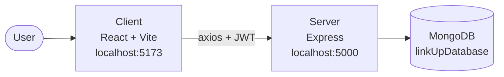
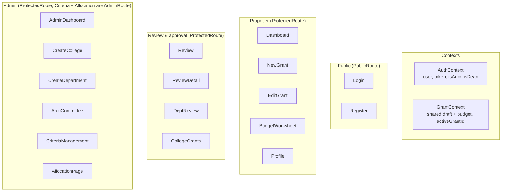
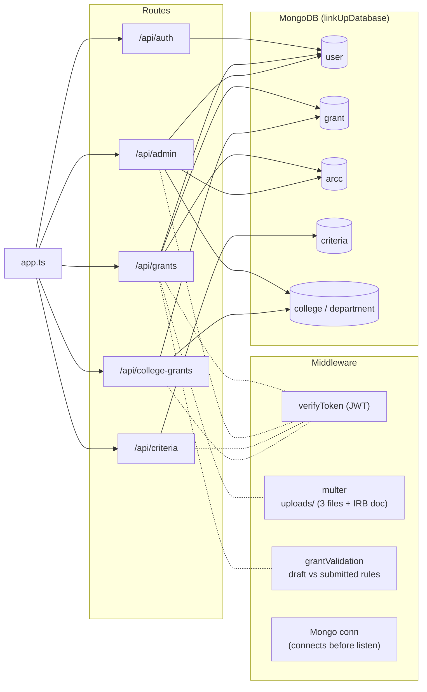
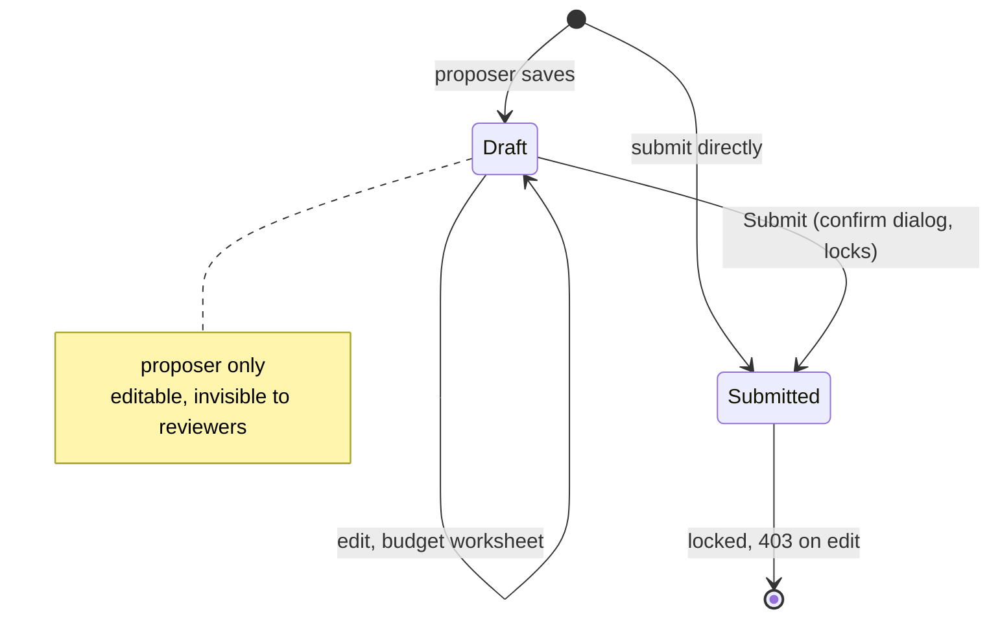
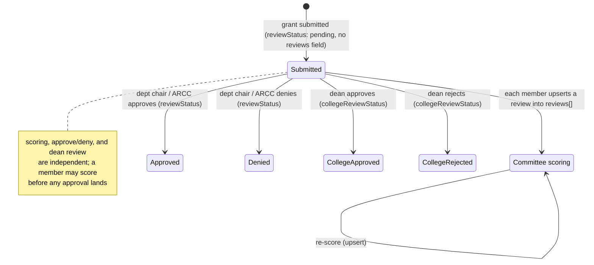
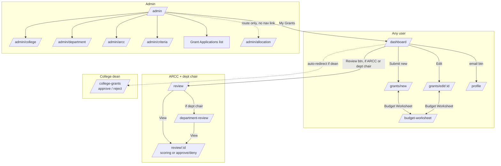
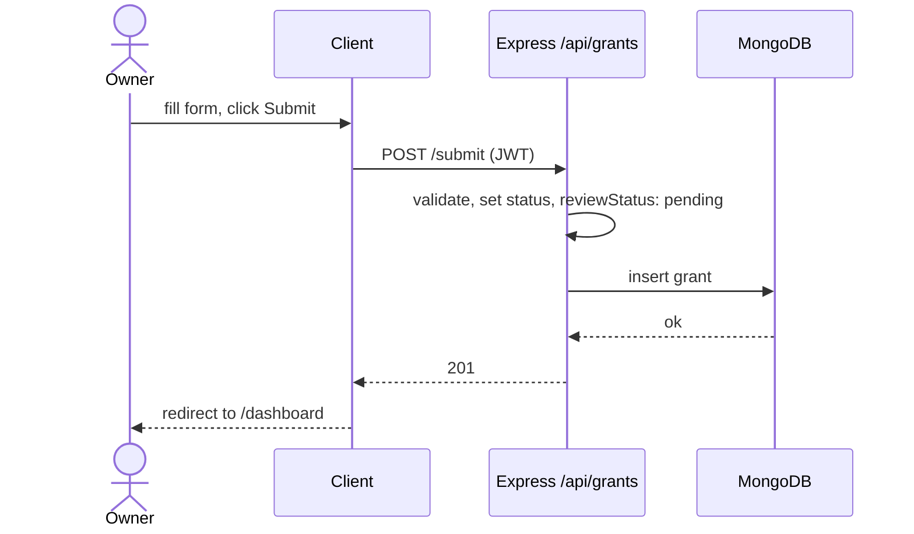
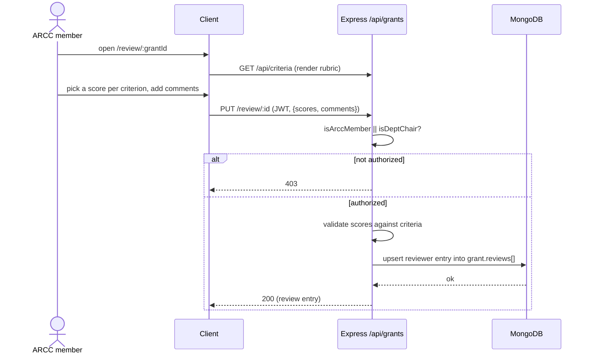

# Architecture and navigation

This describes the current state of the build: how the client, server, and data fit
together, how a user navigates, and where the known gaps are. For what the system is
ultimately meant to do, see [requirements.md](./requirements.md).

Diagrams are Mermaid; GitHub renders them inline, or paste the code blocks into
[mermaid.live](https://mermaid.live).

## System context

A React single-page app talks to an Express API over axios with a JWT bearer token;
Express reads and writes a single MongoDB database through the raw Node driver.

## Client map

Pages grouped by the route guard that wraps them. `PublicRoute` redirects signed-in
users away; `ProtectedRoute` requires a token; `AdminRoute` additionally requires
`role=admin`.

Two contexts back these pages, both persisted to `localStorage`: `AuthContext` holds the
session (`user`, `token`, and the `isDean` flag resolved at login; `isArcc` is populated
from a per-page fetch), and
`GrantContext` holds the shared grant draft and budget items across `NewGrant`,
`EditGrant`, and `BudgetWorksheet`. Page-to-page navigation is in [Navigation](#navigation).

## Server and data map

What each route group handles:

- **`/api/auth`** — register, login, get / update user.
- **`/api/grants`** — submit, edit, get-grant, user-grants, all (admin), and `review*`.
- **`/api/admin`** — colleges, departments, arcc, user-options, checkDeptChair.
- **`/api/criteria`** — CRUD (writes admin-only).
- **`/api/college-grants`** — dean list / get / approve-reject.

`review*` covers `GET /review`, `GET /review/:id`, `GET /review/:id/files/:savedName`,
`GET /review/department`, `PUT /review/:id` (stores a reviewer's per-criterion scores and
comments), and `PUT /review/approval/:id` (sets approve/deny). The GET review endpoints
and both PUTs are open to ARCC members and department chairs (`isArccMember || isDeptChair`).

## Grant lifecycle

A grant carries several independent fields (`server/src/routes/grantSubmission.ts`,
`server/src/routes/collegeGrants.ts`). `status` (`draft` / `submitted`) controls
editability. Reviewing is split across three concurrent tracks that all live on the
grant document, with no separate Review entity:

- **`reviews[]`** — an embedded array, one entry per committee member, each holding
  per-criterion `scores` and `comments`, upserted on re-submit. The field is created on
  the first score, not at submit.
- **`reviewStatus`** (`null` for a draft / `pending` once submitted / `approved` /
  `denied`) — the approve/deny outcome, written by a department chair or ARCC member
  through the approval route. A freshly submitted grant has `reviewStatus: "pending"` and
  no `reviews` field yet.
- **`collegeReviewStatus`** (`approved` / `rejected` / unset) — the college dean's
  decision, written only for a grant that requests money from that dean's college; unset
  reads as pending.

Editing track (`status`):

Review tracks (run once submitted, concurrently):

| status            | field written           | Trigger          | Actor                | Route                                 |
| ----------------- | ----------------------- | ---------------- | -------------------- | ------------------------------------- |
| (new) → draft     | none                    | save as draft    | owner                | `POST /api/grants/submit`             |
| (new) → submitted | `reviewStatus: pending` | submit directly  | owner                | `POST /api/grants/submit`             |
| draft → draft     | none                    | edit, save draft | owner                | `PUT /api/grants/edit/:id`            |
| draft → submitted | `reviewStatus: pending` | submit           | owner                | `PUT /api/grants/edit/:id`            |
| submitted         | `reviews[]` upsert      | score the rubric | ARCC member or chair | `PUT /api/grants/review/:id`          |
| submitted         | `reviewStatus`          | approve / deny   | dept chair or ARCC   | `PUT /api/grants/review/approval/:id` |
| submitted         | `collegeReviewStatus`   | approve / reject | college dean         | `PUT /api/college-grants/:id`         |

## Navigation

`ReviewDetail` (`/review/:id`) gates its controls on how it was reached: navigations pass
`state.fromApprovalView`, so the same page shows the rubric-scoring form when an ARCC
reviewer opens it and the approve/deny controls when a department chair opens it from
`/department-review`.

## Review surfaces

Review rights are not a single flag. A user can be a proposer plus any of: **ARCC
reviewer** (committee membership, `isArccMember`), **department chair**
(`GET /api/admin/checkDeptChair`), **college dean** (email matches a college's `dean`),
or **admin** (`role=admin`). Each role has its own surface:

- **ARCC** `/review` → `/review/:id`: score the grant against the rubric criteria and
  leave comments. Each member upserts one review; the rubric renders inline.
- **Department chair** `/department-review` → `/review/:id`: grants in the chair's
  department; reached from a button on `/review`.
- **College dean** `/college-grants`: only grants with positive funding from the dean's
  college; approve / reject inline (`collegeReviewStatus`), with no separate detail page.
  Reached by an automatic redirect on login.
- **Admin** `/admin`: management pages plus the all-grants list.

Role detection is mixed: `isDean` is resolved at login and kept in `AuthContext`, while
`isArcc` and department-chair status are fetched per page (`GET /api/admin/arcc` and
`checkDeptChair`, from Dashboard and Review).

## Known gaps

- **Admin all-grants list** — the "Grant Applications" rows are plain text with no
  click-through to a read-only `/review/:id`.
- **No shared role-aware header** — navigation is per page rather than from one
  `DashHeader`. ARCC and dept-chair entries are buttons on Dashboard / Review (dept-chair
  gated by a per-page `checkDeptChair` fetch), and the dean reaches `/college-grants`
  through a post-login redirect with no persistent nav link back. `isDean` is resolved at
  login and `isArcc` is page-fetched into `AuthContext`, so a single header could resolve
  all three role flags in one place.
- **No cross-reviewer consolidation** — each reviewer's per-criterion total is computed
  client-side; there is no consolidated, normalized grant-level rating across all
  reviewers for allocation to key off.
- **Allocation page is UI only** — `/admin/allocation` renders placeholder data; the
  cycle inputs and award math are not wired to real grants, and Send to Accounting does
  not export a spreadsheet.

## Roles and permissions

Only two roles live on `user.role` (`user` or `admin`). The review rights are not roles,
they are data-driven and checked per request:

- **ARCC member** — membership in the singleton ARCC committee document, `isArccMember()`.
- **Department chair** — a `department` doc whose `chair` equals the user's email,
  `isDeptChair()` / `GET /api/admin/checkDeptChair`.
- **College dean** — a `college` doc whose `dean` equals the user's email, resolved
  server-side in `collegeGrants.ts`.

A single user can hold several of these at once.

| Capability                                           | user | ARCC | dept chair | dean | admin |
| ---------------------------------------------------- | :--: | :--: | :--------: | :--: | :---: |
| Register, log in, edit own profile                   | yes  | yes  |    yes     | yes  |  yes  |
| Create / edit / submit own grants                    | yes  | yes  |    yes     | yes  |  yes  |
| Score submitted grants vs rubric                     |  no  | yes  |    yes     |  no  |  no   |
| Approve / deny (`reviewStatus`)                      |  no  | yes  |    yes     |  no  |  no   |
| Approve / reject own college (`collegeReviewStatus`) |  no  |  no  |     no     | yes  |  no   |
| Download grant files                                 | own  | yes  |    yes     | own  |  yes  |
| View all grants                                      |  no  |  no  |     no     |  no  |  yes  |
| Manage colleges / departments                        |  no  |  no  |     no     |  no  |  yes  |
| Manage ARCC committee membership                     |  no  |  no  |     no     |  no  |  yes  |
| Manage review criteria                               |  no  |  no  |     no     |  no  |  yes  |

A department chair sees only grants from their own department; a dean sees only grants
that request funding from their college.

## Core sequences

Submit a proposal:

Score a proposal (ARCC reviewer):

Approval is a separate call: a department chair (or ARCC member) sets approve/deny via
`PUT /api/grants/review/approval/:id` (`reviewStatus`), and a college dean approves /
rejects via `PUT /api/college-grants/:id` (`collegeReviewStatus`).
