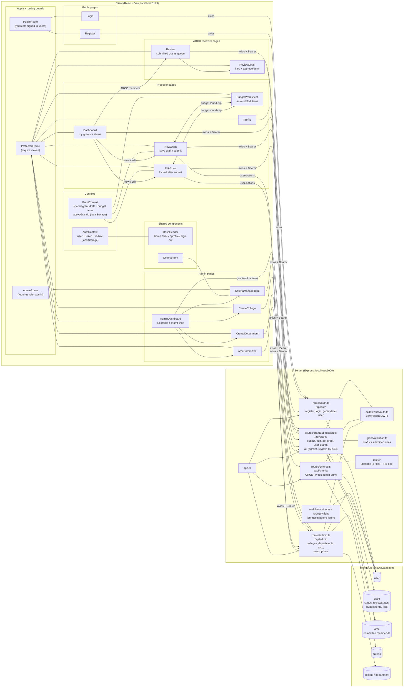
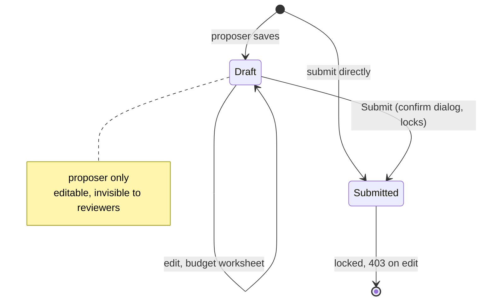
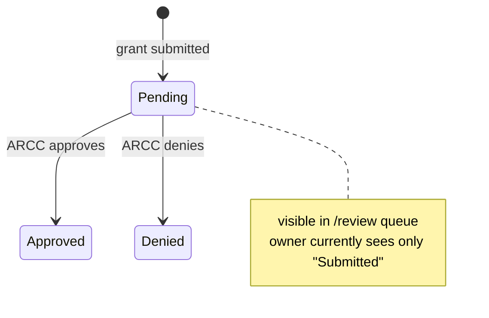
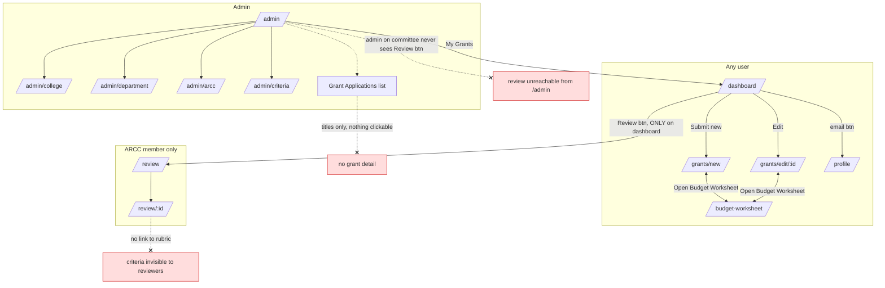
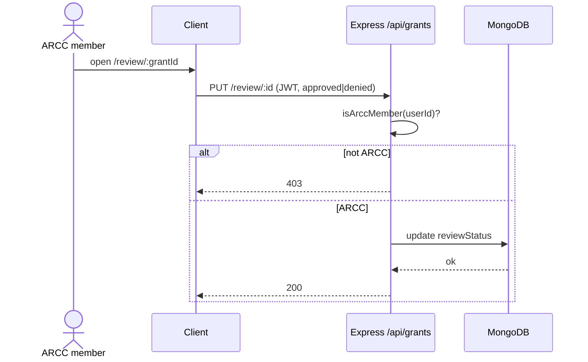

# Architecture and navigation

Diagrams are Mermaid; GitHub renders them inline, or paste the code blocks into [mermaid.live](https://mermaid.live).

## Project overview



`review*` covers `/review`, `/review/:id`, `/review/:id/files/:savedName` (GET) and `/review/:id` (PUT).

## Grant lifecycle

A grant carries two independent fields (`server/src/routes/grantSubmission.ts`): `status`
(`draft` / `submitted`) controls editability, and `reviewStatus`
(`null` / `pending` / `approved` / `denied`) holds the ARCC outcome. There is no separate
Review entity; the outcome lives on the grant. `reviewStatus` flips to `pending` the moment
the grant is submitted.

Editing track (`status`):



Review track (`reviewStatus`, runs once submitted):



| status            | reviewStatus       | Trigger          | Actor       | Route                        |
| ----------------- | ------------------ | ---------------- | ----------- | ---------------------------- |
| (new) → draft     | null               | save as draft    | owner       | `POST /api/grants/submit`    |
| (new) → submitted | pending            | submit directly  | owner       | `POST /api/grants/submit`    |
| draft → draft     | null               | edit, save draft | owner       | `PUT /api/grants/edit/:id`   |
| draft → submitted | pending            | submit           | owner       | `PUT /api/grants/edit/:id`   |
| submitted         | pending → approved | approve          | ARCC member | `PUT /api/grants/review/:id` |
| submitted         | pending → denied   | deny             | ARCC member | `PUT /api/grants/review/:id` |

## Navigation today (dead ends marked)



## Proposed navigation

> Reflects the in-flight review overhaul (open PRs adding rubric scoring, department
> chair review, and college-dean review). It supersedes the earlier single-ARCC
> approve/deny plan: there is no longer one "Review" surface but several role-specific
> ones, and ARCC "approve/deny" is being replaced by per-criterion **scoring +
> comments** (a grant collects many reviews in `grant.reviews[]`). Not yet merged to
> `main`, so the "Navigation today" diagram above still describes the running code.

Review rights are no longer a single flag. A user can be a proposer plus any of:
**ARCC reviewer** (committee membership, `isArccMember`), **department chair**
(`GET /api/admin/checkDeptChair`), **college dean** (email matches a college's `dean`),
or **admin** (`role=admin`). Each role has its own review surface; the header should
surface whichever entry points apply, on every page.

- **ARCC** `/review` → `/review/:id`: score the grant against the rubric criteria and
  leave comments. Multiple reviewers each submit a review; the rubric renders inline
  (resolves the old "criteria invisible to reviewers" dead end).
- **Department chair** `/department-review` → `/review/:id`: grants in the chair's
  department; reached from a button on `/review`.
- **College dean** `/college-grants`: only grants with college funding in the budget;
  approve / reject inline (`collegeReviewStatus`), no separate detail page.
- **Admin** `/admin`: management pages plus the all-grants list, which should become
  clickable through to a read-only detail (still an open dead end, below).

`/review/:id` (ReviewDetail) gates its action controls on how it was reached:
navigations pass `state.fromApprovalView`, so the same page renders read-only when
opened to view and editable when opened to act.

```mermaid
flowchart TD
    subgraph header [DashHeader on every page]
        H1[brand: role-aware home]
        H2[My Grants]
        H3[Review, if ARCC member]
        H4[Department Review, if dept chair]
        H5[College Grants, if college dean]
        H6[Admin, if admin]
        H7[email: profile / Sign out]
    end

    subgraph proposer [Proposer world]
        D[/dashboard/] --> N[/grants/new/]
        D --> E[/grants/edit/:id/]
        N <--> B[/budget-worksheet/]
        E <--> B
        D --- BADGE[per-grant badge:<br/>draft / submitted / review state]
    end

    subgraph arcc [ARCC + department review]
        R[/review/] -->|View| RD[/review/:id/<br/>score vs rubric + comments]
        R -->|if dept chair| DR[/department-review/]
        DR -->|View, fromApprovalView| RD
    end

    subgraph dean [College dean]
        CG[/college-grants/<br/>approve / reject inline]
    end

    subgraph admin [Admin world]
        A[/admin/] --> MGMT[college / department / committee / criteria]
        A --> GL[Grant Applications]
        GL -->|row click, read-only| RD
    end

    H3 --> R
    H4 --> DR
    H5 --> CG
    H6 --> A
    H2 --> D
```

### Still open after the review overhaul

- **DEAD1** Admin "Grant Applications" rows are still plain text; they need
  click-through to a read-only `/review/:id`. No open PR touches `AdminDashboard.tsx`.
- **DEAD2** Review entry points are still not lifted into the header / `AuthContext`,
  so each reviewer can only reach their queue from a specific page. Each role's entry
  (ARCC / dept chair / dean / admin) should live in `DashHeader`, driven by role flags
  resolved once in `AuthContext` rather than re-checked per page.
- **Resolved** The rubric is now visible to reviewers inline on `/review/:id`.

## Roles and permissions

Two roles live on `user.role` (`user` or `admin`). ARCC review rights are not a role: they
come from membership in the singleton ARCC committee document, checked by `isArccMember()`
(`grantSubmission.ts:179`).

| Capability                             | user | ARCC member | admin |
| -------------------------------------- | :--: | :---------: | :---: |
| Register, log in, edit own profile     | yes  |     yes     |  yes  |
| Create / edit / submit own grants      | yes  |     yes     |  yes  |
| Review (approve/deny) submitted grants |  no  |     yes     |  no   |
| Download grant files                   | own  |     yes     |  yes  |
| View all grants                        |  no  |     no      |  yes  |
| Manage colleges / departments          |  no  |     no      |  yes  |
| Manage ARCC committee membership       |  no  |     no      |  yes  |
| Manage review criteria                 |  no  |     no      |  yes  |

## Core sequences

Submit a proposal:


Review a proposal:


