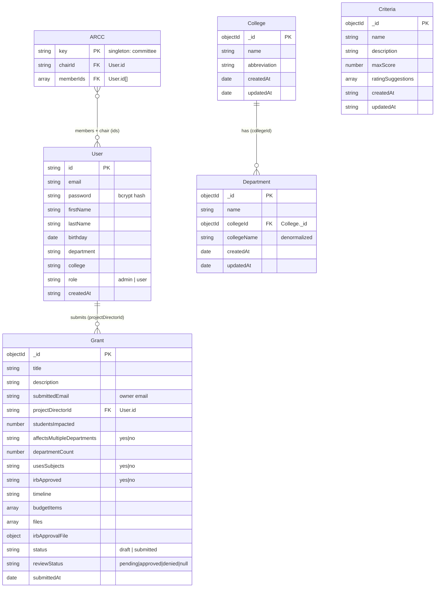

# Data Model

Storage is **MongoDB** accessed through the raw Node driver (no ORM). Collections are
defined implicitly by the insert/update shapes in `server/src/routes/`. The model is
denormalized in places (it copies names alongside ids) which is normal for MongoDB.

## Relationships

- **User 1--\* Grant** — via `Grant.projectDirectorId` (and `submittedEmail` for ownership).
- **College 1--\* Department** — via `Department.collegeId`.
- **ARCC _--_ User** — the singleton committee doc references a `chairId` and a `memberIds`
  array, both pointing at `User.id`. ARCC membership is what grants review rights.
- **Criteria** stands alone, used to score grants during review.

## Sources

| Entity     | Defined in                                 |
| ---------- | ------------------------------------------ |
| User       | `server/src/routes/auth.ts:73`             |
| Grant      | `server/src/routes/grantSubmission.ts:120` |
| College    | `server/src/routes/college.ts:48`          |
| Department | `server/src/routes/department.ts:65`       |
| Criteria   | `server/src/routes/criteria.ts:66`         |
| ARCC       | `server/src/routes/admin.ts:180`           |
