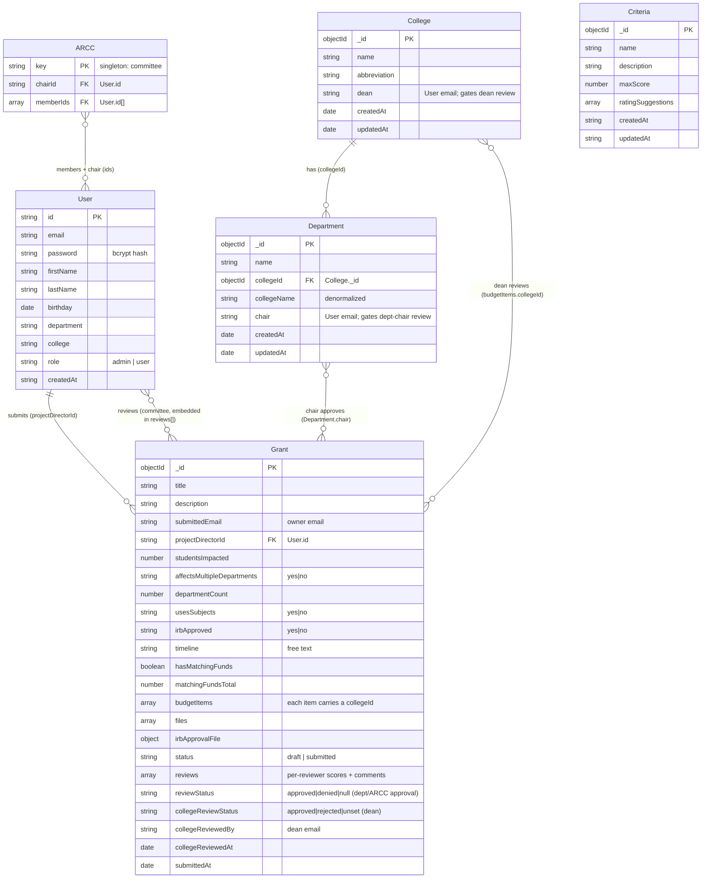

# Data Model

Storage is **MongoDB** accessed through the raw Node driver (no ORM). Collections are
defined implicitly by the insert/update shapes in `server/src/routes/`. The model is
denormalized in places (it copies names alongside ids) which is normal for MongoDB.

_[Open in mermaid.live](https://mermaid.live/edit#pako:eNqtVlGP2zYM_iuEnlLs7vaePd1yvSEoOhTN9lQXBW0xjjZLMii61-xy_32QZTu-yNdia_PkiBRFfuT3SY-q8prUWhHfGawZbeEAAP4MxHA6XV_7R_iN0QmsoVChK62RAKuW_V9UyZ1hqsTzVr8q1Gzjk7_YyPTZ0EOAVeWtNSJEV0C2JK1Jg3Ew2D98nOJsfNNQTWMOd9Qii6Uh3gH7WL3L7PCZV5ZCdUDDgG3L_jMFWJ19b3pTdnIWQRNOmcKq7HRNshWy4SbP5Pb9ZjNG6CGJAWwsmQP8BCmZldGh3zGD7jF9x18QNq4Go-Hdm2yVLJomW20xhAfPGgpVVnxsBQ4YDmNSM8e94SC_o6XM0uClQaMQlIbloPGY-esJx8w0wJKts28ICoXaGgcn6ALxQooVEwrp2yHu0whTasgMJ1_GWdxq-LQMlRhpaCHvULFpxXiX2dKcC-nXEWUolH9wxAPmeaYZG-D-DRQq9vPG6PkG18UJgCCdJidha1ushHQWEfd7qiS87RoxbUPnWQ1QqCOFk_MLYc-t2PhuoR9doLDrerSW44wTx-Vt4on-mpsYS41xsZV7JgKhLzJ3K71vImUOGN6iVAfj6vvO6ZDlbefWP7zgbLCRGY8wIxsUirA6gBGyUCGzoQAIEwXnGaTNe9NQuByXc5HY3JuF-QiC0sXTNONe4HQeivyEURQK1RJfp3-xzZVn6unubd-8BRCT8248bNAnfdLkDOmT65oGVppa-bmXFBxSfrVEmATB-xciMsW6SZ86F0hiUHTfDEP61-Mofdn498Jw4X4rF_YJtozIo9D-Byq7JcXCsowo4iKV-8wTF1MBv0CNQgFmap7X9Fx6pvWu1YuSNLt3_ncxk_c0yUlFBpRuPj1XkufNioLdt8l5ttiYf2jRub91lsFo5TqZfxAkGzZCbPC7u7uo05NwfNlFjmV8RDGu3nV1TSFuDN-6XOYi-UJBPf3y2_lvOsK72KdgXN2QeLeG6ZHzUg--ckOkAtJLYavDM78PH0fPJ3WlLLFFo9Va9VkVSg5kqVDpqbLHrunVOLpiJ353dJVaC3d0pVKNw4MvLT79C6lCOZQ)_

## Relationships

- **User 1--\* Grant** — via `Grant.projectDirectorId` (and `submittedEmail` for ownership).
- **College 1--\* Department** — via `Department.collegeId`.
- **ARCC _--_ User** — the singleton committee doc references a `chairId` and a `memberIds`
  array, both pointing at `User.id`. ARCC membership is what grants review rights.
- **Criteria** stands alone, used to score grants during review.
- **Grant.reviews\[\]** — embedded per-reviewer reviews, not a separate collection. Each
  entry is `{ reviewerId, scores, comments, submittedAt }`, where `scores` maps a
  criterion `_id` to the picked rating. One entry per reviewer (upserted on re-submit).
- **Department chair approval** — `Department.chair` holds a user's email; the chair of
  the submitter's department approves/denies via `Grant.reviewStatus`.
- **College dean review** — `College.dean` holds a user's email. A dean reviews a grant
  only when a budget item references that college (`budgetItems[].collegeId`) with a
  positive college amount; the outcome lives in `Grant.collegeReviewStatus` (plus
  `collegeReviewedBy` / `collegeReviewedAt`).

## Sources

| Entity     | Defined in                                 |
| ---------- | ------------------------------------------ |
| User       | `server/src/routes/auth.ts:73`             |
| Grant      | `server/src/routes/grantSubmission.ts:120` |
| College    | `server/src/routes/college.ts:48`          |
| Department | `server/src/routes/department.ts:65`       |
| Criteria   | `server/src/routes/criteria.ts:66`         |
| ARCC       | `server/src/routes/admin.ts:180`           |
