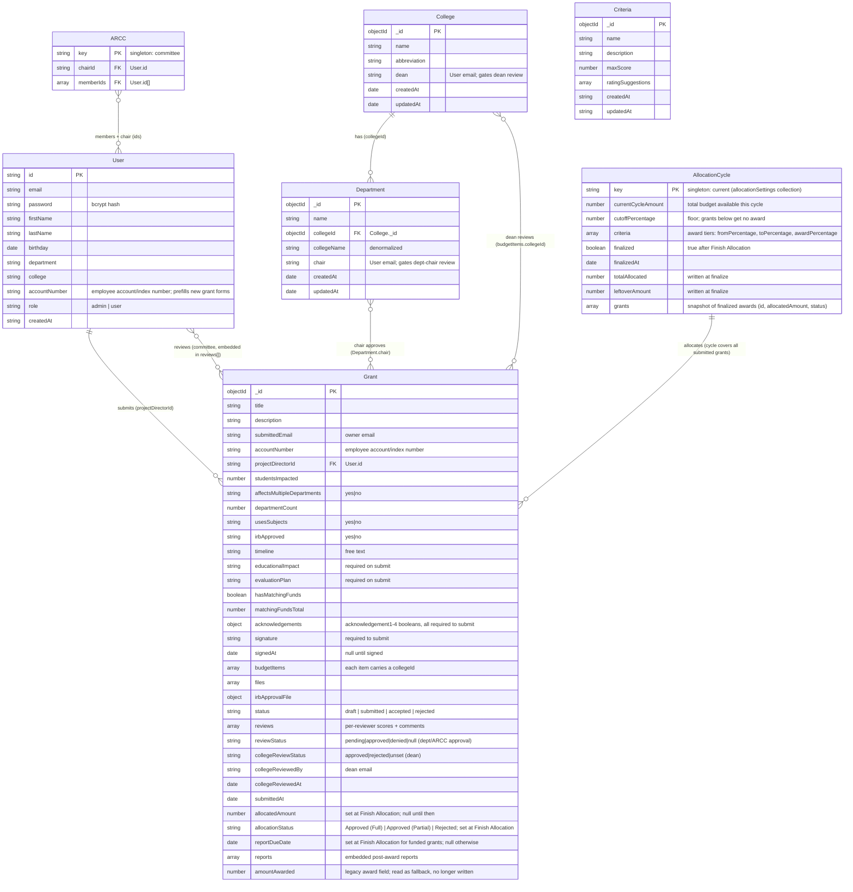

# Data Model

Storage is **MongoDB** accessed through the raw Node driver (no ORM). Collections are
defined implicitly by the insert/update shapes in `server/src/routes/`. The model is
denormalized in places (it copies names alongside ids) which is normal for MongoDB.

_Paste the block into [mermaid.live](https://mermaid.live) to view._

## Relationships

- **User 1--\* Grant** — via `Grant.projectDirectorId` (and `submittedEmail` for ownership).
- **College 1--\* Department** — via `Department.collegeId`.
- **ARCC _--_ User** — the singleton committee doc references a `chairId` and a `memberIds`
  array, both pointing at `User.id`. ARCC membership is what grants review rights.
- **Criteria** stands alone, used to score grants during review.
- **AllocationCycle** is the conceptual name for the singleton document (`key: "current"`)
  in the `allocationSettings` collection, filled in on the allocation page. It holds the
  cycle budget, cutoff percentage, and the award tier array. Saving settings persists
  those inputs; Finish Allocation sets `finalized`, snapshots the awards into `grants`,
  and writes `Grant.allocatedAmount` / `Grant.allocationStatus` / `Grant.reportDueDate`
  (the first June 30 on or after the allocation date, plus one year; `null` for unfunded
  grants) onto each grant.
- **Donor report** — no storage of its own: the `/api/donor-report` route reads funded
  grants (`allocatedAmount > 0`) and joins the submitter's `User.college` /
  `User.department` by email at read time.
- **Grant.reports\[\]** — embedded post-award reports, appended per submission. Each
  entry is `{ reportText, currentProgress, nextSteps, file, submittedAt }`, where `file`
  is an optional uploaded attachment.
- **Grant.reviews\[\]** — embedded per-reviewer reviews, not a separate collection. Each
  entry is `{ reviewerId, scores, comments, submittedAt }`, where `scores` maps a
  criterion `_id` to the picked rating. One entry per reviewer (upserted on re-submit).
  The 0-to-100 rating is computed client-side for display, not stored on the entry.
- **Department chair approval** — `Department.chair` holds a user's email; the chair of
  the submitter's department approves/denies via `Grant.reviewStatus`. No route writes
  `Department.chair`; it is a read-only gating field, set out-of-band (the admin
  create/edit pages send it but the `/api/admin` handlers do not persist it yet).
- **College dean review** — `College.dean` holds a user's email. A dean reviews a grant
  only when a budget item references that college (`budgetItems[].collegeId`) with a
  positive college amount; the outcome lives in `Grant.collegeReviewStatus` (plus
  `collegeReviewedBy` / `collegeReviewedAt`). Like `Department.chair`, `College.dean` is
  read-only with no write route; it is set out-of-band.

## Sources

| Entity          | Defined in                                 |
| --------------- | ------------------------------------------ |
| User            | `server/src/routes/auth.ts:73`             |
| Grant           | `server/src/routes/grantSubmission.ts:120` |
| College         | `server/src/routes/college.ts:48`          |
| Department      | `server/src/routes/department.ts:65`       |
| Criteria        | `server/src/routes/criteria.ts:66`         |
| ARCC            | `server/src/routes/admin.ts:180`           |
| AllocationCycle | `server/src/routes/allocation.ts:500`      |
