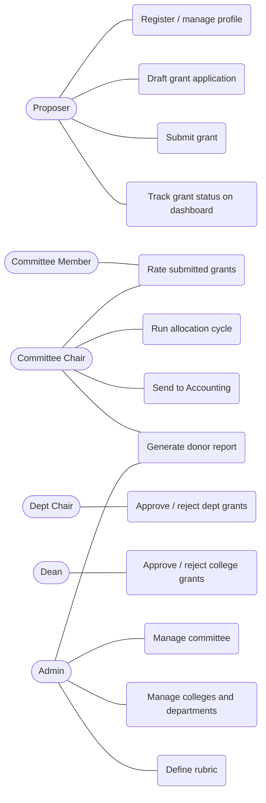

# Use cases

End-to-end walkthroughs of how each role uses the system. These describe expected
behavior; for the per-feature reference see [requirements.md](./requirements.md), and
for known gaps between expectations and the current build see its
[Discrepancies](./requirements.md#discrepancies) section.

## Roles

- **Proposer** — any user. Creates and submits grant applications.
- **Committee member** — an ARCC committee member. Rates submitted grants.
- **Committee chair** — a committee member who also manages the grant-cycle allocation
  and generates the donor report.
- **Department chair** — approves or rejects grants from their department.
- **College dean** — approves grants that request money from their college.
- **Admin** — manages users, the committee, colleges/departments, and the rubric.

A user can hold more than one role (the chair is also a committee member; a department
chair is also a proposer).

---

## Use case diagram



---

## Proposer

### Register and set up a profile

1. The proposer registers with email, password, name, and birthday, and may select
   their college and department.
2. From their profile page they can later update any of these details, plus their
   account number, which prefills the account number field on new grant applications.

### Draft and submit a grant

1. The proposer opens a new grant application and enters the title, description, their
   account number, project director (defaulting to themselves), number of students
   impacted, and whether more than one department is affected.
2. If the project uses human or animal subjects, they attach the required IRB approval
   file.
3. They attach up to three optional supporting files.
4. They build the budget worksheet: one entry per item, each with a description, a
   hardware/software category, and amounts from ARCC, college, department, and other
   sources. Per-item totals compute automatically.
5. If matching funds are available, they check the box and either type the amount or
   use the Pull from budget button to fill it with the worksheet's non-ARCC total.
6. They enter a timeline as free text.
7. They describe how the project enhances the educational experience of Weber State
   students and how the project will be evaluated; both text areas are required.
8. They check the required acknowledgements in the Acknowledgements & Signature section,
   which the form requires before a submit is accepted.
9. They **save** at any point to keep working later, or **submit** when ready.
10. After submitting, the grant is locked and enters review; it can no longer be edited.

### Track grants

1. The proposer's dashboard organizes grants into four sections: saved drafts,
   submitted, approved, and rejected. A submitted grant can hold several statuses at
   once (committee review,
   department-chair review, dean review), and the proposer sees each as pending, approved,
   or rejected, so they can chase an approver who has not yet acted.
2. Once allocation is finalized, the grant moves to the approved or rejected section with
   a terminal status. Approved grants display their awarded amount, and an Approved
   Grants page lists them with the last report date and a submit/update report action.
3. Draft grants offer an edit option; submitted grants are read-only.

---

## Committee member

### Rate a submitted grant

1. The committee member opens the Review navigation item.
2. The review list shows every submitted grant with the principal investigator's name,
   the title, and the total requested from ARCC. A member does not review their own
   submitted grant.
3. They open a grant to view it read-only and download any submitted files via links.
4. They rate the application against each rubric criterion, choosing one option per
   criterion from its dropdown, and may add a note. The system computes a final rating
   from 0 to 100 (points awarded over criteria maximums, times 100) for display; only the
   per-criterion ratings are stored with the review. Submitting again updates the same
   reviewer's review rather than adding another. Rating does not approve or deny the grant.

---

## Committee chair

The chair does everything a committee member does, plus:

### Set the cycle allocation

1. On the allocation page (available only to the chair), the chair enters the current
   cycle amount and cutoff percentage in editable text boxes; a read-only leftover box
   shows the cycle amount minus the total allocated.
2. The cutoff applies as it is edited: grants below the cutoff move to the Rejected
   Grants table, unreviewed grants sit in Pending Review, and the rest stay in the
   Approved Grants table.
3. The chair adjusts the cutoff as many times as needed to accommodate more applicants.
4. For the eligible grants, the chair adds dynamic tier criteria: each tier maps a rating
   range to a percentage of the requested amount (the top tier, e.g. 90-100%, awards
   100% of the request). An Allocated Amount column updates as tiers are configured.
5. When satisfied, the chair clicks Finish Allocation. This locks the allocation and sets
   each grant's final status (Approved (Full), Approved (Partial), or Rejected). Funded
   grants receive a calculated report due date (next June 30 after the allocation date,
   plus one year).
6. Send to Accounting stays disabled until Finish Allocation completes. Once the cycle is
   finalized, the chair clicks it to download the accounting spreadsheet (PI, grant name,
   accounting number, submitter, amounts, final rating, allocated amount, status) for the
   accounting office to disburse.

### Generate the donor report

1. The chair (or an admin) opens Donor Report from the header navigation.
2. The charts tab shows money received per college and per department, grant counts per
   award-amount bucket, and the top 5 grants by amount received.
3. The all-grants tab lists every funded grant, filterable by college, department, and
   an amount range, to answer live questions from funders.

---

## Department chair

### Approve or reject a department grant

1. When a grant is submitted, it is routed to the proposer's department chair for
   approval.
2. The chair sees a department-grants list shaped like the review list.
3. The chair approves or rejects each grant, verifying it relates to the proposer's job
   duties.

---

## College dean

### Approve grants that draw on the college

1. When a submitted grant requests more than $0 from the dean's college, the grant is
   routed to that dean. If no college funds are requested, the dean is not involved.
2. The dean approves or rejects the grant for their college's portion.

---

## Admin

### Manage the ARCC committee

1. The admin opens the committee page showing two lists: current members and all users.
2. They add users to the committee from the all-users list, or remove existing members.
3. They designate one member as chair; choosing a new chair replaces the previous one.

### Manage colleges and departments

1. Under separate tabs, the admin creates and edits colleges and departments.
2. For a college, the admin selects its dean from a dropdown of users; for a department,
   its chair from a dropdown of users. Editing also fills in a dean or chair skipped at
   creation, or moves a department to a different college.

### Manage the rubric

1. The admin defines scoring criteria, each with a name, a description, its own maximum
   score, and a set of rating options ("number: description"). The top option equals
   that criterion's maximum and the bottom option is always 0; in-between options are
   the admin's choice.
2. They add as many criteria as the rubric needs.

---

## Key scenarios

Given/When/Then for the flows worth pinning down precisely. These map to the behavior
the role walkthroughs above describe.

```gherkin
Feature: Submit a grant

  Scenario: Proposer submits a complete grant
    Given a logged-in proposer with a draft that has all required fields
    And the account number and acknowledgements are filled in
    When they click Submit and confirm
    Then the grant status becomes "submitted"
    And the grant is locked against further edits
    And it enters committee and department-chair review

  Scenario: Submit is blocked until acknowledgements are checked
    Given a logged-in proposer with an otherwise complete grant
    And at least one required acknowledgement is unchecked
    When they click Submit
    Then submission is rejected with a validation error
    And the grant remains an editable draft
```

```gherkin
Feature: Score a submitted grant

  Scenario: ARCC member scores against the rubric
    Given an ARCC committee member viewing a submitted grant they did not submit
    When they pick one option per rubric criterion and add a note
    And they submit the rating
    Then the review is saved in the grant's reviews[]
    And the reviewer's 0-to-100 score is computed for display
    And re-submitting updates that reviewer's review rather than adding another
```

```gherkin
Feature: Department chair approval

  Scenario: Chair approves a grant from their department
    Given a department chair viewing a submitted grant from their department
    When they approve it
    Then the grant's departmentReviewStatus becomes "approved"

  Scenario: Chair rejects a grant
    Given a department chair viewing a submitted grant from their department
    When they reject it
    Then the grant's departmentReviewStatus becomes "denied"
```

```gherkin
Feature: College dean approval

  Scenario: Dean approves a grant that requests college funds
    Given a submitted grant with a budget item requesting more than $0 from the dean's college
    When the dean opens college-grants and approves it
    Then the grant's collegeReviewStatus becomes "approved"

  Scenario: A grant that requests no college funds skips dean approval
    Given a submitted grant that requests $0 from every college
    Then it does not appear in any dean's college-grants list
    And no dean approval is required
```

```gherkin
Feature: Allocation cutoff

  Scenario: Setting a cutoff splits grants into tables
    Given the chair has set a cutoff of 75
    Then reviewed grants with an average rating >= 75 appear in the Approved Grants table
    And grants with an average rating < 75 appear in the Rejected Grants table

  Scenario: Adjusting the cutoff re-splits the tables
    Given the chair previously set a cutoff of 70
    When they change the cutoff to 80
    Then the Approved and Rejected Grants tables update to reflect the new threshold
```

```gherkin
Feature: Allocation tiers

  Scenario: Tier criteria compute the allocated amount
    Given a grant requesting $8,000 with an 88% average rating
    And the chair has configured: above 90% gets 100%, 80-90% gets 75%
    When the chair applies the tier criteria
    Then the grant's Allocated Amount shows $6,000

  Scenario: Grant in the top tier receives 100%
    Given a grant requesting $10,000 with a 95% average rating
    And the top tier 90-100% awards 100%
    When the chair applies the tier criteria
    Then the grant's Allocated Amount shows $10,000
```

```gherkin
Feature: Finish Allocation

  Scenario: Finish Allocation locks the cycle and sets terminal statuses
    Given the chair has configured cutoff and tier criteria
    When they click Finish Allocation
    Then no further changes to the allocation page are possible
    And each funded grant's status is "Approved (Full)" or "Approved (Partial)"
    And each grant in the Rejected Grants table has status "Rejected"

  Scenario: Funded grant receives a report due date
    Given Finish Allocation is clicked on 2025-10-20
    And a grant is in the Approved Grants table
    Then that grant's report due date is 2027-06-30

  Scenario: Report due date when allocation finalizes near fiscal year end
    Given Finish Allocation is clicked on 2026-06-23
    And a grant is in the Approved Grants table
    Then that grant's report due date is 2027-06-30

  Scenario: Send to Accounting is disabled before finalization
    Given the allocation cycle has not been finalized
    Then the Send to Accounting button is disabled
    And the server rejects the CSV export for an unfinalized cycle

  Scenario: Send to Accounting works after finalization
    Given the chair has clicked Finish Allocation
    When they click Send to Accounting
    Then the accounting CSV downloads
```

```gherkin
Feature: Proposer dashboard sections

  Scenario: Accepted grant appears in the approved section
    Given a grant that received an allocated amount after Finish Allocation
    When the proposer views their dashboard
    Then the grant appears in the Approved Grants section
    And it displays its report due date

  Scenario: Rejected grant appears in the rejected section
    Given a grant that fell below the cutoff after Finish Allocation
    When the proposer views their dashboard
    Then the grant appears in the Rejected Grants section
    And the proposer can see it was rejected so they have a record of the application
```

```gherkin
Feature: Report due-date reminder banner

  Scenario: Reminder for a report due soon
    Given an approved grant with no filed report
    And its report due date is 30 days away
    When the proposer views their dashboard
    Then a banner says the report is due in 30 days
    And a File report link navigates to the Approved Grants page

  Scenario: Reminder for an overdue report
    Given an approved grant with no filed report
    And its report due date passed 10 days ago
    When the proposer views their dashboard
    Then a banner says the report is overdue by 10 days

  Scenario: No reminder outside the window or after filing
    Given an approved grant whose report is due more than 90 days away,
      overdue by more than a year, or already filed
    When the proposer views their dashboard
    Then no reminder appears for that grant
```
